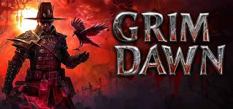

**Grim Dawn is the definitive dark fantasy ARPG with a dual-class mastery system, 10 masteries combinable into 45 unique builds, set in a grim Victorian-era world ravaged by supernatural factions. Loot-driven progression rewards deep build experimentation.**

---

## 📖 About

Grim Dawn is the definitive dark fantasy ARPG with a dual-class mastery system, 10 masteries combinable into 45 unique builds, set in a grim Victorian-era world ravaged by supernatural factions. Loot-driven progression rewards deep build experimentation.

## ⚠️ Problems Without Trainer

| Problem | Status |
|---------|--------|
| **Build Complexity** — Poor skill synergies can make characters non-viable late-game | ✅ Solved |
| **Resist Capping** — Not capping resistances makes endgame content instantly lethal | ✅ Solved |
| **Nemesis Difficulty** — Nemesis enemies scale beyond unprepared characters | ✅ Solved |
| **Crafting RNG** — Best items require rare blueprint drops and specific materials | ✅ Solved |

## ✅ Solution

The **Grim Dawn Trainer** solves all these issues by giving you complete control over the game.

## 🎯 Full Feature List

- Unlimited Resources
- God Mode / Invincibility
- Instant Skill Cooldown
- One-Hit Kill
- Freeze Game Timer
- Unlock All Items & Achievements
- Custom Speed Multiplier
- Save State Anywhere

## 🚀 Quick Start

1. **Disable Windows Defender** temporarily (trainer may trigger false positive)
2. Download the trainer from the button above
3. Launch Grim Dawn
4. Run the trainer as Administrator
5. Activate desired cheats with hotkeys

## 💎 Free vs Paid

| Feature | Free | Pro |
|---------|------|-----|
| Basic God Mode | ✅ | ✅ |
| Unlimited Resources | ✅ | ✅ |
| All Advanced Cheats | ❌ | ✅ |
| Auto-Updates | ❌ | ✅ |
| Priority Support | ❌ | ✅ |

## 💻 Requirements

- Windows 10/11 (64-bit)
- Grim Dawn (any version)
- .NET Framework 4.8+
- DirectX 11+

## 🍎 macOS

macOS users can use our alternative tool:

## ⚖️ Legal

This trainer is for educational and single-player use only. Use responsibly.

---

